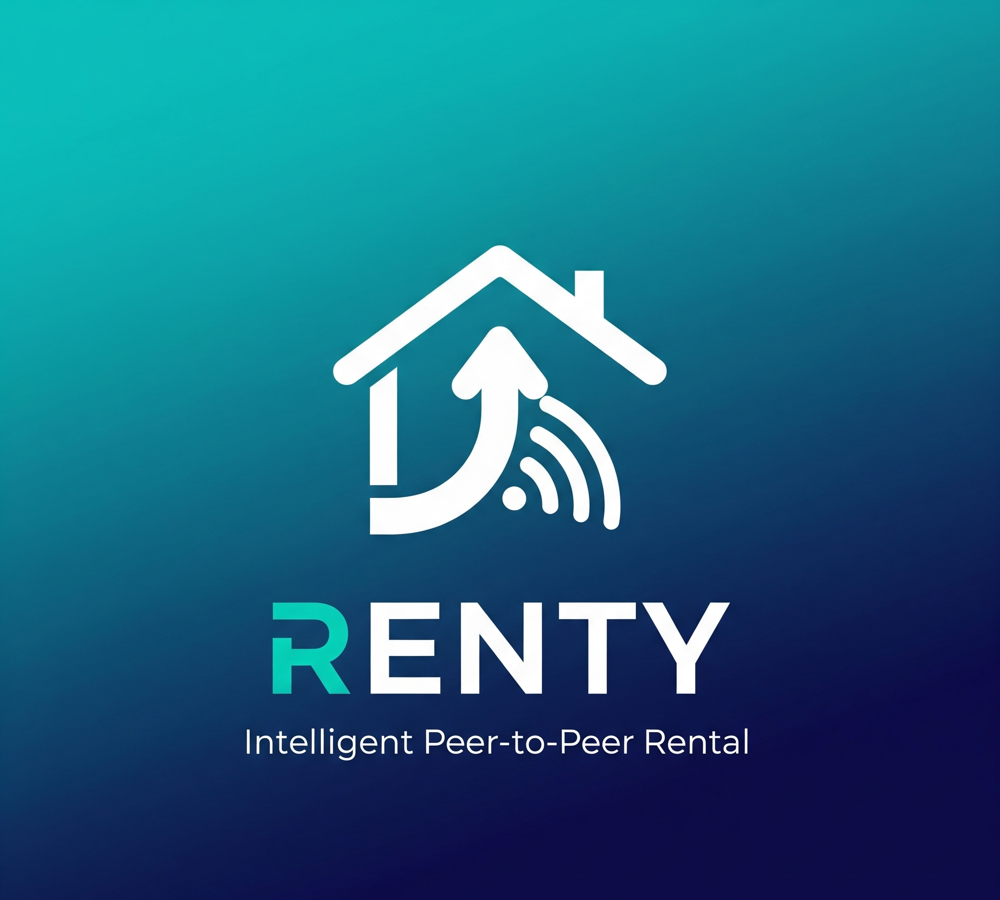
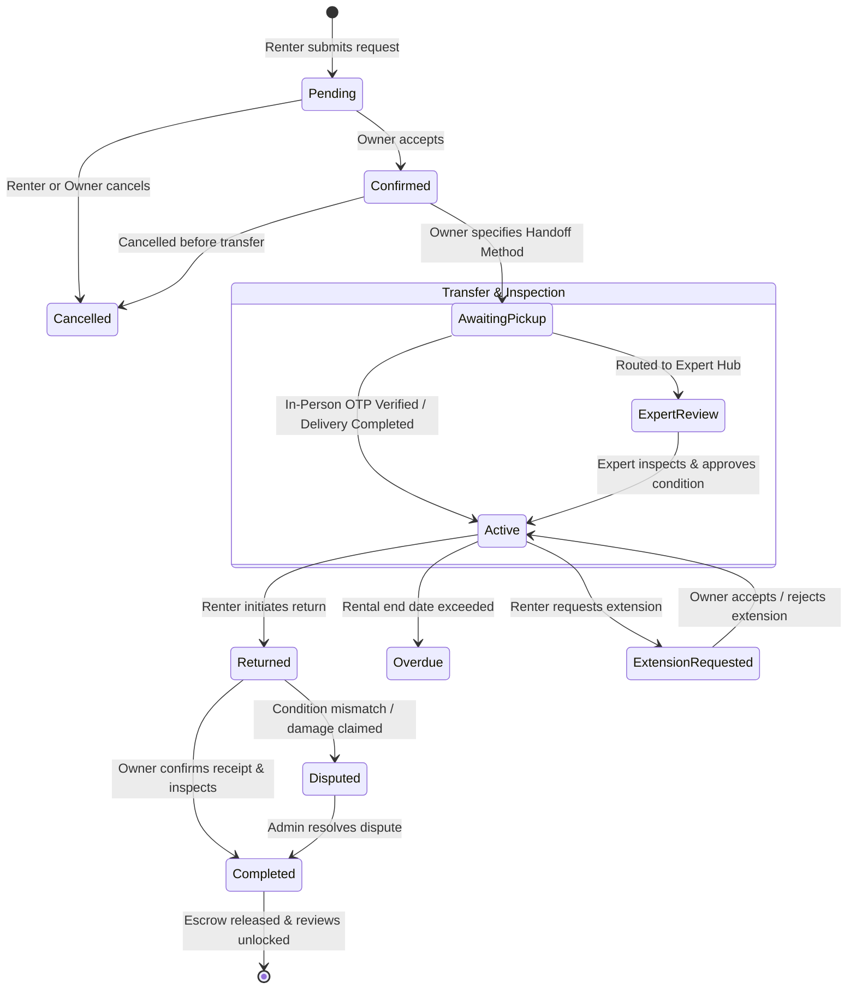

<div align="center">

  

  #  Renty Mobile Application
  ### *Intelligent Peer-to-Peer Rental & Sharing Economy Platform*

  [](https://flutter.dev)
  [](https://dart.dev)
  [](https://bloclibrary.dev)
  [](https://dotnet.microsoft.com/apps/aspnet/signalr)
  [](https://pub.dev/packages/flutter_secure_storage)
  [-orange?style=for-the-badge&logo=google-translate&logoColor=white)](https://flutter.dev/docs/development/accessibility-and-localization/internationalization)

  <p align="center">
    <strong>A production-ready, enterprise-grade cross-platform mobile application delivering a secure peer-to-peer rental ecosystem. Powered by BLoC state management, SignalR real-time communications, AI-driven recommendation pipelines, hardware-backed cryptography, and bilingual RTL support.</strong>
  </p>

  <p align="center">
    <a href="#-key-features">Key Features</a> •
    <a href="#-technical-architecture">Architecture</a> •
    <a href="#-rental-lifecycle-state-machine">Rental Workflow</a> •
    <a href="#-security-engineering">Security</a> •
    <a href="#-tech-stack--libraries">Tech Stack</a> •
    <a href="#-project-structure">Project Structure</a> •
    <a href="#-getting-started">Getting Started</a>
  </p>

</div>

---

##  Executive Summary

**Renty** solves the trust, logistics, and verification bottlenecks inherent in peer-to-peer asset rentals. Built with **Flutter** and engineered according to modern **Clean Architecture & BLoC** patterns, the application provides a unified dual-role experience where users can seamlessly switch between **Renters** (discovering and borrowing assets) and **Item Owners** (listing products, managing custody, and generating rental income).

### What Sets Renty Apart:
-  **Zero-Compromise Security**: Pre-boot root/jailbreak detection shielding sensitive financial operations, paired with AES-256 hardware Keystore/Keychain token vaults and automated JWT rotation.
-  **Real-Time Duplex Communication**: SignalR WebSocket hubs delivering instant chat, voice notes recording/playback, typing indicators, live support ticketing, and badge counters.
-  **Certified Physical Item Verification**: Integrated workflows routing high-value items through certified physical expert inspection hubs with pre- and post-rental photo audits.
-  **Escrow-Backed Digital Wallet**: Automated security deposit holds, duration calculations, platform fee deductions, and withdrawal ledgers.
-  **Native Bilingual Experience**: Pixel-perfect English and Arabic localization with full bidirectional layout flipping (RTL/LTR) styled with the Cairo typography system.

---

##  Key Features

### 1.  Intelligent Marketplace & Discovery
- **Multi-Level Category Hierarchy**: High-performance exploration across product categories, subcategories, and verified brands.
- **Advanced Dynamic Search & Filtering**: Multi-parameter search filtered by price range, distance/geolocation, availability calendar, item condition, and ratings.
- **AI-Powered Recommendation Engine**: Integrated with a hybrid recommendation model (collaborative filtering + content-based) delivering personalized item suggestions tailored to user behavior.
- **Dynamic Availability Calendar**: Interactive booking calendars (`table_calendar`) highlighting reserved blackout dates and real-time availability.

### 2.  End-to-End P2P Rental Lifecycle
- **Unified Dual-Role Interface**: Renter and Owner views intelligently resolved from session context and resource IDs.
- **Full Finite State Machine**: Deterministic transitions: `Pending` ➔ `Confirmed` ➔ `AwaitingPickup` ➔ `Active` ➔ `Returned` ➔ `Completed` (with branches for `Disputed`, `Cancelled`, and `Overdue`).
- **Cryptographic Transfer OTPs**: Secure six-digit custody handoff codes verified in real time before items change hands.
- **Flexible Handoff Logistics**: In-person handoffs (`ByHand`) or delivery courier dispatch (`DeliveryService`).
- **In-App Rental Extensions**: Seamless extension requests with real-time price recalculation and owner approval/rejection flows.

### 3.  Quality Assurance & Expert Inspection Hubs
- **Expert Physical Hub Assignment**: High-value items can be routed to certified inspection centers for condition certification before release.
- **Condition Photo Audits**: Mandatory pre-rental and return photo uploads timestamped and stored as cryptographic audit logs.
- **Dispute Resolution Engine**: Transparent dispute initiation with evidence submission, photo logs, and administrative mediation.
- **Dual-Sided Ratings & Reviews**: Post-rental 5-star ratings and written reviews with verified renter badges.

### 4.  Real-Time Communications (SignalR WebSockets)
- **Persistent Duplex Chat**: ASP.NET Core SignalR client maintaining WebSocket connections with automatic fallback and reconnection.
- **Voice Notes Recording & Playback**: In-app audio recorder (`record`) with inline playback and waveform controls.
- **Media & Attachment Sharing**: Real-time image and attachment transfer directly in conversation threads.
- **Interactive Live Support**: Direct channel to customer support agents with ticket status lifecycle and real-time typing indicators.
- **Live Notification Hub**: Real-time push updates for booking confirmations, transfers, chat messages, and reminders.

### 5.  Digital Wallet & Escrow Payments
- **Integrated In-App Wallet**: Real-time balance updates, top-ups, transaction histories, and bank withdrawal requests.
- **Escrow-Style Financial Protection**: Rental fees and refundable security deposits held in escrow until mutual post-inspection completion.
- **Transparent Fee Breakdown**: Clear itemization of daily rates, duration discounts, platform service fees, and refundable deposits.

### 6.  Localization & Design System
- **Dual-Language Engine**: Full English & Arabic (العربية) translation system with dynamic runtime switching.
- **Bidirectional UI Support**: Comprehensive Right-to-Left (RTL) and Left-to-Right (LTR) adaptive layout design.
- **Custom Typography**: Specially tailored typography powered by the Google Cairo font family.
- **Adaptive Dark / Light Themes**: Custom color palettes, surface tones, elevation hierarchies, and smooth micro-animations.

---

##  Technical Architecture

Renty Mobile adheres to **Clean Architecture** principles, enforcing separation of concerns, high testability, and decoupled business logic:

```
lib/
├── api/                   #  Auto-generated OpenAPI v1 Client (Strict Backend Parity)
│   ├── lib/api/           # Concrete API services (Auth, Rentals, Items, Chat, etc.)
│   └── lib/model/         # 270+ Immutable DTOs & Request/Response Models
├── auth/                  #  Authentication Pages (Login, Register, OTP, Password Reset)
├── component/             #  Reusable UI Components, Form Inputs, Buttons, Loaders
├── core/
│   ├── blocs/             #  BLoC & Cubit State Management Layer
│   │   ├── home/          # Home state & cubits
│   │   ├── marketplace/   # Product search, category filters & catalog
│   │   ├── rentals/       # Rental list & state transitions
│   │   ├── item_detail/   # Item detail, pricing calculations & booking
│   │   ├── orders/        # Order tracking & management
│   │   ├── search/        # Real-time search & filter parameters
│   │   ├── navigation/    # Bottom navigation & container tabs
│   │   └── notification/  # Notification badge live streaming
│   ├── class/             # Base wrappers & Request status handlers (StatusRequest)
│   ├── constant/          # App colors, design tokens, typography, asset paths
│   ├── middleware/        # Route authentication guards
│   ├── services/          #  Singleton Infrastructure Services
│   │   ├── api_service.dart               # OpenAPI orchestrator & client provider
│   │   ├── auth_interceptor.dart          # Mutex-locked 401 JWT refresh interceptor
│   │   ├── secure_storage_service.dart    # Android Keystore & iOS Keychain vault
│   │   ├── chat_signalr_service.dart      # Real-time chat WebSocket client
│   │   ├── support_signalr_service.dart   # Live support ticket WebSocket client
│   │   └── notification_signalr_service.dart # Real-time notification hub client
│   └── utils/             # Navigator keys, validators, image converters
├── pages/                 #  Presentation Layer (30+ Screens)
│   ├── rental_detail_page.dart            # Complex rental lifecycle hub & actions
│   ├── item_detail_page.dart              # Product showcase & rental booking modal
│   ├── chat_room_page.dart                # Real-time SignalR chat with voice notes
│   ├── wallet_page.dart                   # Digital wallet balance & escrow ledger
│   ├── expert_assigned_page.dart          # Physical verification inspection hub
│   └── support_tickets_page.dart          # Customer support portal
├── routes.dart            #  Centralized routing table (AppRoutes & transitions)
├── utils/                 #  Localization, ThemeManager, FavoritesManager
└── main.dart              #  Pre-boot security check & App entrypoint
```

---

##  Rental Lifecycle State Machine

The rental process is modeled as an explicit, resilient finite state machine:



---

##  Security Engineering

Security is designed as a core platform pillar rather than an afterthought:

| Security Vector | Implementation Detail | Benefit |
| :--- | :--- | :--- |
| **Device Integrity** | Pre-boot inspection via `flutter_jailbreak_detection` | Blocks execution on rooted/jailbroken devices, preventing memory dumping and Keystore bypasses. |
| **Hardware Cryptography** | `flutter_secure_storage` with Android AES-256 Keystore & iOS Keychain (`first_unlock_this_device`) | Zero plaintext tokens in persistent storage; immune to file extraction attacks. |
| **Silent JWT Refresh** | `AuthInterceptorClient` with token queuing & mutex locking | Intercepts HTTP 401s, executes refresh commands transparently, replays pending calls, and terminates sessions on failure. |
| **Custody Handshake** | Dynamic 6-digit Time-based OTP verification (`verify-transfer`) | Guarantees non-repudiation during physical item transfers. |
| **Photo Timestamping** | Multipart image uploads tagged with `RentalImageType` (Before / After) | Creates verifiable evidence trails for damage disputes. |

---

##  Tech Stack & Libraries

### Core Framework
- **Flutter SDK**: `^3.9.2` (Null Safety, Material 3, Cupertino styling)
- **Dart SDK**: `^3.9.2`

### State Management & Architecture
- **flutter_bloc** (`^8.1.6`) & **equatable** (`^2.0.5`): Predictable, reactive, event-driven state flows.
- **dartz** (`^0.10.1`): Functional programming paradigms (Either / Option error handling).

### Networking & Real-Time
- **OpenAPI Generator**: 100% type-safe DTO and client generation synced with backend ASP.NET Core endpoints.
- **http** (`^1.5.0`) & **http_parser** (`^4.1.0`): Custom HTTP client with token injection & multipart uploads.
- **signalr_netcore** (`^1.3.7`): Real-time bidirectional WebSocket transport for chat, notifications, and support.

### Hardware, Audio & Peripherals
- **record** (`^6.2.0`): High-fidelity microphone voice recording for chat messages.
- **image_picker** (`^1.1.2`): Camera and gallery capture for verification and item listings.
- **geolocator** (`^14.0.2`): GPS positioning for proximity-based item searches.

### UI, Animations & Experience
- **table_calendar** (`^3.1.3`): Booking calendar with blackout range selection.
- **lottie** (`^3.3.2`): Vector animations for interactive transitions and empty states.
- **shimmer** (`^2.0.0`): Loading placeholder skeletons for smooth data fetching.
- **cached_network_image** (`^3.3.0`): Memory- and disk-cached CDN image rendering.
- **pin_code_fields** (`^8.0.1`): Smooth OTP input fields for transfer verification.

---

##  Key Modules Breakdown

###  Real-Time Chat & Voice Messaging (`pages/chat_room_page.dart`)
- **SignalR Hub Synchronization**: Real-time message streaming with status flags (`Sent`, `Delivered`, `Read`).
- **Voice Note System**: Integrated recording workflow with duration timers and inline audio playback.
- **Contextual Item Linking**: Directly displays the rented item banner at the top of the chat for immediate context.

###  Rental Details & Actions (`pages/rental_detail_page.dart`)
- **Dynamic Action Panels**: Automatically presents contextual actions based on logged-in role (`Renter` vs `Owner`) and current rental state.
- **Financial Breakdown Widget**: Live breakdown of daily rates, deposits, platform fees, and refund statuses.
- **Transfer OTP Card**: Generates and validates custody transfer PINs.

###  Physical Inspection Hub (`pages/expert_assigned_page.dart`)
- **Third-Party Certification**: Coordinates logistics for routing items to expert hubs.
- **Inspection Checklist**: High-resolution image capture for baseline item condition before rental release.

###  Escrow & Wallet Management (`pages/wallet_page.dart`)
- **Balance Overview**: Live wallet balance, locked escrow funds, and available payout balances.
- **Transaction History**: Color-coded incoming earnings, security deposit holds, and withdrawals.

---

##  Getting Started

### Prerequisites
- **Flutter SDK**: `3.9.0` or higher ([Install Flutter](https://docs.flutter.dev/get-started/install))
- **Dart SDK**: `3.9.2` or higher
- **Android Studio** (with Android SDK 21+) / **Xcode** (for iOS builds)
- A physical device or emulator (Note: Rooted devices will trigger the security blocker screen)

### Installation & Setup

1. **Clone the repository**:
   ```bash
   git clone https://github.com/your-username/renty-mobile.git
   cd renty-mobile
   ```

2. **Install dependencies**:
   ```bash
   flutter pub get
   ```

3. **Verify Flutter setup**:
   ```bash
   flutter doctor
   ```

4. **Run the Application**:
   - **For Debug Mode**:
     ```bash
     flutter run
     ```
   - **For Release Mode (Performance Profiling)**:
     ```bash
     flutter run --release
     ```

5. **Build Application Bundles**:
   - **Android APK**:
     ```bash
     flutter build apk --split-per-abi
     ```
   - **Android App Bundle (Play Store)**:
     ```bash
     flutter build appbundle
     ```
   - **iOS IPA (App Store)**:
     ```bash
     flutter build ipa
     ```

---

##  Engineering Highlights (Portfolio Showcase)

This application represents an enterprise-grade mobile software development standard, specifically showcasing:

1. **Clean Code & Solid Architecture**: Strict separation of data, business logic (BLoC), and presentation layers without tight coupling.
2. **WebSocket & Real-Time Mastery**: Production-tested ASP.NET Core SignalR client implementation handling connection drops, reconnect backoffs, and stream multiplexing.
3. **Enterprise Mobile Security**: Hardware Keystore/Keychain integration, proactive jailbreak/root prevention, and memory-cached secure token management.
4. **Resilient Network Architecture**: Auto-generated contract-first OpenAPI client paired with custom mutex-locked token refresh interceptors.
5. **Fluid Internationalization (i18n)**: Seamless bidirectional RTL/LTR support designed from the ground up for Arabic and English typography.

---

##  License & Acknowledgments

This project was developed as part of a **Graduation Project** for the Faculty of Computers and Data Science (**FCDS**), demonstrating modern software engineering, distributed systems, and mobile application architectures.

Licensed under the [MIT License](LICENSE).

---

---

<div align="center">

  ###  Mobile App by **Yasser Ashraf**

  <p align="center">
    <a href="https://www.linkedin.com/in/yasserashraf/"></a>
    &nbsp;
    <a href="https://github.com/Yasserashraf1"></a>
    &nbsp;
    <a href="https://yasser-ashraf-production-ready-mobile-apps.vercel.app/"></a>
  </p>

  <p align="center">
    <sub>Connect with me: <a href="https://www.linkedin.com/in/yasserashraf/">LinkedIn</a> • <a href="https://github.com/Yasserashraf1">GitHub</a> • <a href="https://yasser-ashraf-production-ready-mobile-apps.vercel.app/">Personal Website</a></sub>
  </p>

  <sub>Built with ❤️ using Flutter, Dart & ASP.NET Core SignalR</sub>

</div>


