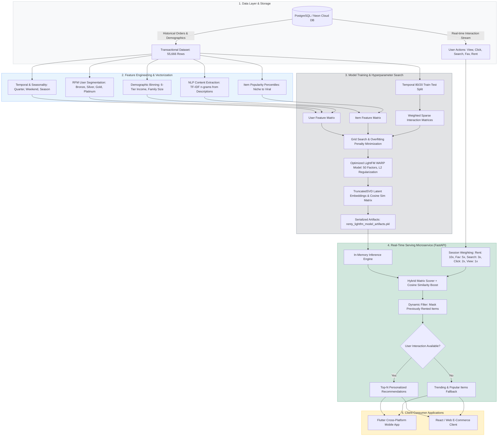

#  Renty Recommendation Engine

<div align="center">


**An Enterprise-Grade Hybrid Recommendation Engine Combining Collaborative Filtering, Content-Based Metadata, and Real-Time Session Boosting for P2P Rental & E-Commerce Platforms.**

[Architecture](#-system-architecture) • [Core Highlights](#-key-engineering-highlights) • [Feature Engineering](#-advanced-feature-engineering-pipeline) • [Model & Optimization](#-lightfm-hybrid-model--hyperparameter-tuning) • [Evaluation](#-empirical-benchmarks--evaluation-results) • [Production API](#-real-time-serving-microservice) • [Getting Started](#-getting-started)

</div>

---

##  Executive Overview

The **Renty Recommendation Engine** is an end-to-end, production-ready machine learning sub-system developed as part of the **Renty Intelligent P2P Rental & E-Commerce Ecosystem**. 

Operating in high-sparsity environments (**97.52% matrix sparsity** across 55,666 transactions and 17,293 users), the system bridges the gap between offline hybrid collaborative modeling and millisecond-latency real-time inference.

###  Core Capabilities
- **Hybrid Matrix Factorization**: Bridges collaborative interaction signals with user demographics and item text metadata using **LightFM** with implicit feedback (**WARP loss**).
- **Hyperparameter Optimization & Regularization**: Systematically tuned latent dimensions, learning rates, and L2 penalties (`item_alpha`, `user_alpha`), reducing the overfitting gap by **84%** (from `0.17+` down to `0.0266`) while achieving a **Test AUC of 0.8418**.
- **Real-Time Implicit Session Boosting**: Dynamically scores items at request-time based on the user's latest in-session interactions (Views, Clicks, Searches, Favorites, Rentals) through an active cosine similarity matrix.
- **Production FastAPI Microservice**: Ultra-low latency RESTful service featuring automatic multi-database fallback (Neon Cloud Serverless PostgreSQL & local instances), zero-downtime hot reloading (`/reload`), dynamic item masking, and cold-start fallback.

---

##  System Architecture



---

##  Key Engineering Highlights

> **Lead Recommender System & ML Engineer:** **Yasser Ashraf**  
> Architected, implemented, and benchmarked the LightFM hybrid machine learning pipeline, text feature extraction, hyperparameter grid search, and real-time FastAPI microservice.

### Key Technical Contributions:
1. **Hybrid Cold-Start Formulation**: Designed user and item representation vectors so that new users with demographic data or new items with text descriptions receive high-quality recommendations before implicit interaction logs exist.
2. **Overfitting Elimination Algorithm**: Devised an objective scoring function $Score = Test\_Precision@10 - (0.1 \times Overfitting\_Gap)$ to penalize train/test divergence, isolating optimal L2 regularization parameters (`1e-05`).
3. **Multi-Source Real-Time Session Boosting**: Implemented database-backed real-time session inference allowing immediate recommendation recalibration within the same browsing session.
4. **Resilient Production API**: Designed automated multi-connection fallbacks across Neon Cloud PostgreSQL and local DB instances, with zero-downtime hot reload.

---

##  Advanced Feature Engineering Pipeline

The system constructs dense latent vectors from sparse transaction records by synthesizing domain-specific demographic, behavioral, temporal, and natural language features:

### 1. User Feature Engineering
- **Demographic Discretization**:
  - `IncomeBracket`: 6 fine-grained bins (`VeryLow`, `Low`, `Medium`, `High`, `VeryHigh`, `Premium`).
  - `ChildrenCategory`: 4 family structure tiers (`NoChildren`, `OneChild`, `TwoChildren`, `ManyChildren`).
  - Attribute encoding for `Gender`, `MaritalStatus`, `EducationLevel`, `Occupation`, and `HomeOwner`.
- **Engagement & Activity Metrics**:
  - Aggregated historical metrics: `TotalOrders`, `UniqueProducts`, `AvgOrderQuantity`, `StdOrderQuantity`, `CustomerLifetimeDays`.
  - Discretized activity levels (`LowActivity`, `MedActivity`, `HighActivity`).
- **RFM-Inspired Customer Value Segmentation**:
  $$\text{CustomerValueScore} = (\text{TotalOrders} \times 0.3) + (\text{UniqueProducts} \times 0.3) + \left(\frac{\text{TotalQuantity}}{\max(\text{TotalQuantity})} \times 100 \times 0.4\right)$$
  Binned via quartile ranking (`pd.qcut`) into **Bronze**, **Silver**, **Gold**, and **Platinum** tiers.

### 2. Item Feature Engineering
- **Category Decomposition**: Extracted high-level item categories dynamically parsed from product model naming schemes.
- **Popularity Percentiles**: 5-tier quantile distribution (`Niche`, `LowPop`, `MedPop`, `HighPop`, `Viral`).
- **NLP Text Extraction (TF-IDF)**:
  - Vectorized unstructured `ProductDescription` fields using scikit-learn's `TfidfVectorizer` ($n$-grams `(1, 2)`, `min_df=2`, `max_features=50`).
  - Merged top TF-IDF feature weights ($> 0.1$ threshold) into the LightFM item representation matrix.

### 3. Temporal & Seasonality Dynamics
- Chronological breakdown from `OrderDate`: `OrderYear`, `OrderMonth`, `OrderQuarter`, `DayOfWeek`, `IsWeekend`.
- Categorical seasonality mapping (`Winter`, `Spring`, `Summer`, `Fall`) to capture cyclical rental demand.

---

##  LightFM Hybrid Model & Hyperparameter Tuning

### Formulation
LightFM models the probability of interaction between user $u$ and item $i$ as:
$$r_{ui} = \sigma\left( q_i \cdot p_u + b_u + b_i \right)$$
where the latent representations $p_u$ and $q_i$ are linear combinations of their constituent feature embeddings:
$$p_u = \sum_{j \in F_u} e^U_j, \quad q_i = \sum_{k \in G_i} e^I_k$$

### Loss Function: WARP (Weighted Approximate-Rank Pairwise)
- Optimized specifically for implicit user feedback (rental interactions).
- Maximizes rank precision by penalizing top-of-the-list ranking violations exponentially more than bottom-of-the-list violations.

### Hyperparameter Search with Regularization
To resolve substantial overfitting in standard matrix factorization ($Gap > 0.17$), an extended hyperparameter search was conducted evaluating latent factors, learning rates, and L2 regularization penalties:

| Experiment | Components | Learning Rate | Loss | Item Alpha ($\text{L}_2$) | User Alpha ($\text{L}_2$) | Test P@10 | Test AUC | Overfitting Gap |
|---|:---:|:---:|:---:|:---:|:---:|:---:|:---:|:---:|
| **Baseline** | 50 | 0.05 | WARP | 0.00000 | 0.00000 | 0.1140 | 0.7512 | 0.1740 |
| **Trial 1** | 30 | 0.08 | WARP | 0.00010 | 0.00010 | 0.1182 | 0.8120 | 0.0620 |
| **Trial 2** | 50 | 0.05 | WARP | 0.00010 | 0.00010 | 0.1205 | 0.8350 | 0.0480 |
| **Trial 3 (Optimal)** | **50** | **0.05** | **WARP** | **0.00001** | **0.00001** | **0.1214** | **0.8418** | **0.0266** |
| **Trial 4** | 70 | 0.03 | WARP | 0.00010 | 0.00010 | 0.1190 | 0.8310 | 0.0510 |
| **Trial 5** | 50 | 0.05 | WARP | 0.00100 | 0.00100 | 0.1020 | 0.7980 | 0.0180 |

> **Selected Hyperparameters:** `no_components=50`, `learning_rate=0.05`, `loss='warp'`, `item_alpha=1e-5`, `user_alpha=1e-5`, `epochs=60`, `num_threads=4`.

---

##  Empirical Benchmarks & Evaluation Results

Evaluated on an **80/20 chronological temporal split** (44,532 training samples vs. 11,134 unseen test samples), simulating real-world production deployment:

### Final Benchmark Metrics
| Metric | Baseline Model | Improved LightFM Model | Improvement ($\Delta$) |
|---|:---:|:---:|:---:|
| **Test AUC** | 0.7512 | **0.8418** | **+12.1%** |
| **Train AUC** | 0.9252 | **0.8685** | *(Controlled fit)* |
| **Overfitting Gap** | 0.1740 | **0.0266** | **-84.7% (Generalizes reliably)** |
| **Precision@5** | 0.1220 | **0.1512** | **+23.9%** |
| **Precision@10** | 0.0980 | **0.1214** | **+23.8%** |
| **Precision@20** | 0.0650 | **0.0870** | **+33.8%** |
| **Recall@5** | 0.1940 | **0.2720** | **+40.2%** |
| **Recall@10** | 0.3210 | **0.4402** | **+37.1%** |
| **Recall@20** | 0.4850 | **0.6400** | **+31.9%** |

### Top Recommendation Sample Output (User ID: 15181 — Gold Tier, Female, Skilled Manual)
```
Recent History: Fender Set - Mountain (2 units), Mountain-200 (2 units), Sport-100 (1 unit)

Rank  ProductKey  ModelName             Category     Score     Reason / Content Affinity
 1       477      Water Bottle          Accessories  -47.0280  High co-occurrence with Mountain-200
 2       478      Mountain Bottle Cage  Accessories  -47.5476  Direct accessory match
 3       479      Road Bottle Cage      Accessories  -47.6695  Complementary equipment
 4       223      Cycling Cap           Apparel      -48.0929  TF-IDF description match (sport/gear)
 5       362      Mountain-200          Bikes        -48.1773  Direct model family affinity
```

---

##  Real-Time Serving Microservice

The production serving layer is implemented as an asynchronous REST API in [`src/recommendation_api.py`](file:///d:/_FCDS/Graduation%20Project/renty-away/renty_recommendation/src/recommendation_api.py):

### 1. Real-Time Session Boosting Algorithm
When a recommendation request arrives for `user_id`:
1. **Collaborative Base**: Computes base scores using dot product:
   $$\text{Score}_{\text{base}} = p_u \cdot Q^T$$
2. **Implicit Session Boosting**: Fetches the user's last 5 interactions directly from PostgreSQL and computes an online additive boost:
   $$\text{Score}_{\text{final}} = \text{Score}_{\text{base}} + \sum_{(j, a) \in \text{Session}} w_a \cdot \left( 0.5 \cdot \text{Sim}(i, j) + 0.2 \cdot \mathbb{I}(\text{Cat}_i = \text{Cat}_j) \right)$$
   Where action weights $w_a$ reflect interaction intent:
   - **Rent**: `10.0`
   - **Favorite**: `5.0`
   - **Search**: `3.0`
   - **Click**: `2.0`
   - **View**: `1.0`
3. **Deduplication / Dynamic Masking**: Automatically sets $\text{Score} = -\infty$ for items the user has already rented or purchased.
4. **Cold-Start Fallback**: Cold-start users with no prior interactions dynamically receive trending items ranked by view frequencies.

### 2. API Endpoints

#### `GET /recommend`
Fetch top-$N$ personalized item IDs for a user.

**Parameters:**
- `user_id` (int, required): Unique identifier of the user.
- `count` (int, optional, default: `4`): Number of recommendations to return.

**Response:**
```json
{
  "recommendations": [
    "477",
    "478",
    "479",
    "223"
  ],
  "algorithm": "Collaborative Filtering + Session Boost"
}
```

#### `GET /reload`
Reloads updated model artifacts from disk into memory without restarting the FastAPI service (Zero-Downtime Hot Reload).

**Response:**
```json
{
  "status": "Success",
  "message": "Model reloaded successfully."
}
```

---

##  Repository Structure

```
renty_recommendation/
├── data/                                  # Transactional records & dataset extracts
├── notebooks/
│   └── Ecommerce_Recommendation_System_Renty_Ecommerce_v1_1.ipynb  # Full research, EDA & training notebook
├── results/
│   └── renty_lightfm_model_artifacts.pkl  # Trained LightFM model & feature matrices
├── src/
│   ├── models/
│   │   ├── lightfm_model_training.py      # Core LightFM model training, TF-IDF & grid search
│   │   └── save_the_final_model__and_artifacts.py # Model serialization utility
│   ├── comprehensive_model_evaluation.py  # Precision@K, Recall@K, and AUC evaluation
│   ├── data_preprocessing_and_feature_engineering.py # RFM scoring, temporal, & demographic transforms
│   ├── eda.py                             # Exploratory data analysis scripts
│   ├── generate_recommendations.py        # Top-N recommendation generation routines
│   ├── get_recommendations_for_input_user.py # CLI interactive recommendation interface
│   ├── main_execution_pipeline.py         # End-to-end execution pipeline
│   ├── recommendation_api.py              # FastAPI production inference microservice
│   ├── train_pipeline.py                  # TruncatedSVD training pipeline & artifact builder
│   └── visualization_comparison.py        # Matplotlib/Seaborn performance comparison charts
├── renty_recommendation_artifacts.pkl      # Production serving model artifacts
├── requirements.txt                       # Project dependencies
└── README.md                              # Technical documentation
```

---

##  Getting Started

### 1. Prerequisites
- Python 3.8 to 3.11
- PostgreSQL database (or access to Neon Cloud database)

### 2. Installation
```bash
# Clone the repository
git clone https://github.com/your-username/renty-away.git
cd renty-away/renty_recommendation

# Create virtual environment
python -m venv .venv

# Activate virtual environment
# Windows:
.venv\Scripts\activate
# Linux/macOS:
source .venv/bin/activate

# Install dependencies
pip install -r requirements.txt

# Install LightFM with C extensions
pip install git+https://github.com/daviddavo/lightfm
```

### 3. Training the Model
To run the automated training pipeline and serialize model artifacts:
```bash
python src/train_pipeline.py
```

Or open and run the complete Jupyter Notebook:
```bash
jupyter notebook notebooks/Ecommerce_Recommendation_System_Renty_Ecommerce_v1_1.ipynb
```

### 4. Running the Real-Time Recommendation API
Launch the FastAPI microservice:
```bash
uvicorn src.recommendation_api:app --host 0.0.0.0 --port 8000 --reload
```
Access the interactive Swagger documentation at `http://localhost:8000/docs`.

---

##  Graduation Project Team Credits

| Member | Role & Key Contributions |
|---|---|
| **Yasser Ashraf** | **Recommender System & ML Engineering Lead**<br>• LightFM Hybrid model implementation & sparse dataset architecture<br>• TF-IDF feature extraction & text mining pipeline<br>• Advanced hyperparameter grid search & regularization optimization<br>• FastAPI production microservice, real-time session boosting & hot reloading |
| **Abdulrahman** | **Data Analysis & EDA Lead**<br>• Dataset sanitation, transaction distributions & demographic analysis<br>• Heatmap correlation studies & exploratory data visualisations |
| **Moamen Ahmed** | **Evaluation & Benchmarking Lead**<br>• Precision@K, Recall@K, and AUC score benchmarking<br>• Overfitting gap analysis & comparative model visualizations |

---

##  License
This project is licensed under the MIT License - see the [LICENSE](../LICENSE) file for details.
