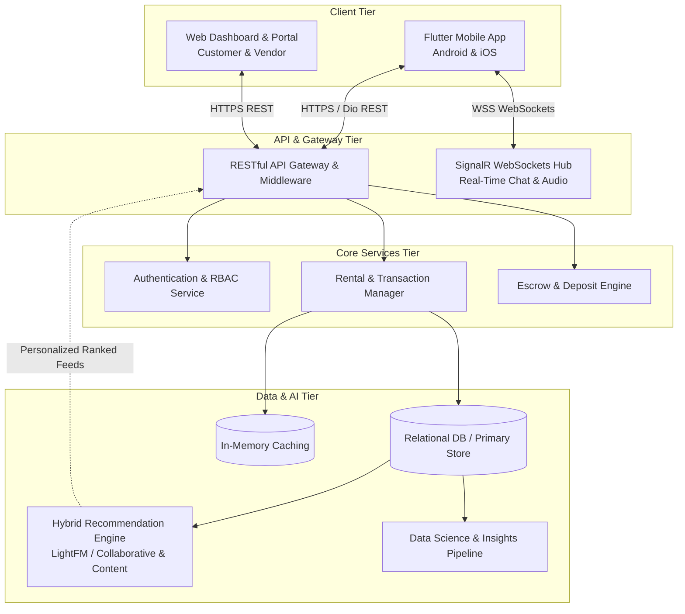

#  Renty — Decentralized Peer-to-Peer Sports Equipment Rental & Sharing Platform

[](https://flutter.dev)
[](https://dart.dev)
[](https://www.python.org/)
[](https://github.com/lyst/lightfm)
[](https://dotnet.microsoft.com/apps/aspnet/signalr)
[]()
[]()

> **Graduation Capstone Project**  
> **Faculty of Computer and Data Science (FCDS), Alexandria University**  
> An enterprise-grade, peer-to-peer (P2P) circular-economy ecosystem designed to bridge sports gear accessibility through secure rentals, AI-powered hyper-personalized discovery, native mobile client hardening, and enterprise business intelligence.

---

##  Table of Contents
1. [Executive Summary](#-executive-summary)
2. [High-Level System Architecture](#-high-level-system-architecture)
3. [Key Modules & Technical Deep-Dive](#-key-modules--technical-deep-dive)
   - [A. Cross-Platform Mobile Application](#a-cross-platform-mobile-application-flutter)
   - [B. Web Application & Core Backend](#b-web-application--core-backend)
   - [C. Recommendation Engine (AI/ML)](#c-recommendation-engine-aiml)
   - [D. Data Science, BI & Gap Analysis](#d-data-science-bi--gap-analysis)
4. [Technology Stack](#-technology-stack)
5. [Engineering Team & Contributions](#-engineering-team--contributions)
6. [Security & Application Hardening](#-security--application-hardening)
7. [Repository Structure](#-repository-structure)
8. [Installation & Setup](#-installation--setup)

---

##  Executive Summary

High-performance sporting equipment represents a significant financial barrier to entry, while existing gear frequently sits idle. **Renty** solves this supply-demand mismatch by creating a trusted, local, and community-driven sharing economy platform.

### Core Value Propositions:
- **For Renters:** Access professional equipment on-demand at a fraction of retail prices with localized pickup and verified condition tracking.
- **For Item Owners:** Monetize idle gear with risk-mitigated escrow workflows, deposit protection, and identity verification.
- **For the Platform:** Drive platform stickiness using an advanced **Hybrid Recommendation Engine** and continuous market **Gap Analysis** to balance localized supply and demand.

---

##  High-Level System Architecture



---

##  Key Modules & Technical Deep-Dive

### A. Cross-Platform Mobile Application (Flutter)
*Engineered by **Yasser Ashraf** (Lead)*

Built with **Flutter** using **Clean Architecture** principles and **BLoC/Cubit** state management across **30+ production screens**:

- **Predictable State Architecture:** Strict decoupling between Presentation, Domain (UseCases, Entities), and Data Layers (Repositories, Remote/Local Data Sources).
- **Real-Time Communication:** Instant peer-to-peer text and voice messaging powered by **SignalR WebSockets** with native background notification listeners and audio recording/playback controllers.
- **Bilingual & Typography Engine:** Comprehensive bi-directional localization (**English/Arabic LTR & RTL**) using custom Cairo typography, responsive design tokens, and dynamic Dark/Light theming.
- **Geo-Spatial Discovery:** Google Maps integration, distance radii calculations, geofenced item discovery, and interactive search filters.
- **Resilient Offline Architecture:** Token lifecycle management using Dio interceptors, auto-recovery on network drops, and cached feed hydration.

### B. Web Application & Core Backend
*Engineered by **Hamza Omran**, **Ahmed Khalifa**, and **Moaz Moustafa***

- **Full-Stack Web Portal:** Responsive customer catalog and administrative vendor dashboard for inventory, verification reviews, and order arbitration.
- **Secure RESTful Architecture:** High-throughput backend routing, token-based authorization (Bearer JWT), and multi-tenant Role-Based Access Control (RBAC).
- **Escrow & Order Lifecycle Engine:** Finite State Machine (FSM) managing rental requests: `Requested` $\rightarrow$ `Approved` $\rightarrow$ `Escrow Funded` $\rightarrow$ `Item Handed Over` $\rightarrow$ `Returned & Inspected` $\rightarrow$ `Deposit Released`.
- **Engineering Gap Analysis:** Rigorous architectural gap analysis comparing user behavior against system capabilities to minimize friction in the conversion funnel.

### C. Recommendation Engine (AI/ML)
*Architected by **Yasser Ashraf** with Data Science Collaboration*

A production-ready **Hybrid Recommendation Engine** combining matrix factorization and explicit metadata constraints:

- **Algorithmic Foundation:** Powered by **LightFM**, uniting:
  1. **Collaborative Filtering:** Learns latent user/item affinity representations from rental histories, wishlists, and item clicks.
  2. **Content-Based Filtering:** Incorporates item metadata (sport category, condition tier, brand, price band) to resolve cold-start issues for newly listed gear.
- **Geographic Distance Penalty:** Recommendation scores are real-time weighted by geospatial proximity, prioritizing gear available within the user's travel radius.
- **Adaptive Re-Ranking:** Real-time re-ranking triggered by in-session navigation patterns.

### D. Data Science, BI & Gap Analysis
*Engineered by **Abdelrahman Hesham** & **Moamen Ahmed***

- **Exploratory Data Analysis (EDA):** Deep analysis of rental velocity, seasonality patterns (e.g., winter vs. water sports), and regional supply deficits.
- **Market Gap Analysis:** Identifying high-demand / low-supply geographic pockets to incentivize owner inventory listings.
- **Pricing Optimization Models:** Dynamic suggested rental pricing based on gear original retail price, age, wear-and-tear degradation, and seasonal demand curves.
- **Executive BI Dashboards:** Visualizations and cohort analyses evaluating churn, repeat rental frequency, dispute ratios, and average transaction values.

---

##  Technology Stack

| Domain | Technologies & Libraries |
|---|---|
| **Mobile Client** | Flutter, Dart, BLoC/Cubit, Riverpod, Dio, GetIt, Cairo Font, Google Maps SDK |
| **Mobile Security** | `flutter_secure_storage`, Android Keystore, iOS Keychain, Kotlin `FLAG_SECURE` |
| **Real-Time** | SignalR WebSockets, Native Audio Recording & Streaming |
| **Web Platform** | HTML5, CSS3, JavaScript, Responsive Component Frameworks |
| **Backend & APIs** | RESTful APIs, JWT Authentication, Regional Routing, Escrow State Engine |
| **AI / Machine Learning** | Python, LightFM, Scikit-Learn, NumPy, Pandas |
| **Data Science & BI** | EDA Pipelines, Data Visualization (Matplotlib, Seaborn), FL Chart, Gap Analysis |
| **DevOps & Testing** | Git, GitHub Actions, Postman, Android Studio, VS Code, Google Play Console |

---

##  Engineering Team & Contributions

| Member | Academic Role | Key Engineering Deliverables |
|---|---|---|
| **Yasser Ashraf** | **Team Leader**<br/>Mobile App Lead & RS Engineer | • Architected the Flutter mobile app (Clean Architecture, BLoC/Cubit, 30+ screens).<br/>• Engineered native client security (Root detection, `FLAG_SECURE`, Keystore/Keychain).<br/>• Integrated SignalR WebSockets P2P chat and bilingual RTL/LTR Cairo UI.<br/>• Designed & deployed the LightFM Hybrid Recommendation Engine. |
| **Hamza Omran** | Full-Stack Software Engineer | • Engineered web frontend interfaces and administrative management modules.<br/>• Developed core backend endpoints and database business logic.<br/>• Conducted architectural and market gap analysis. |
| **Ahmed Khalifa** | Full-Stack Software Engineer | • Co-developed web client architecture, responsive styling, and vendor workflows.<br/>• Implemented secure authentication, session handling, and data validation layers.<br/>• Contributed to backend order processing and system gap analysis. |
| **Moaz Moustafa** | Full-Stack Software Engineer | • Designed API integration pipelines and backend transactional state handling.<br/>• Built interactive customer web views and account settings modules.<br/>• Participated in system testing, schema optimizations, and gap analysis. |
| **Abdelrahman Hesham** | Data Scientist & BI Analyst | • Conducted end-to-end data processing, feature extraction, and exploratory analysis.<br/>• Formulated market gap insights, supply/demand clustering, and business KPIs.<br/>• Built interactive visualization reporting pipelines for platform analytics. |
| **Moamen Ahmed** | Data Scientist & ML Specialist | • Prepared model datasets, data wrangling, missing-value imputations, and normalization.<br/>• Supported recommendation engine feature engineering and model evaluation.<br/>• Performed statistical validation on pricing models and user behavior patterns. |

---

##  Security & Application Hardening

Because Renty facilitates financial deposits and high-value physical asset handoffs, security was implemented at the core:

1. **Native Client Hardening:**
   - **Root / Jailbreak Detection:** Startup blocking gates terminate sessions on compromised devices.
   - **Memory & UI Protection:** Android `FLAG_SECURE` prevents background snapshots, screenshots, and OS screen recording of sensitive rental details.
   - **Hardware-Backed Encryption:** Tokens and user credentials are encrypted using AES-256 via the **Android Keystore** and **iOS Keychain**.
2. **Network & Communications Security:**
   - Strict Bearer token validation with centralized automated refresh interceptors.
   - Encrypted WebSockets connections with handshake-level user authentication.
3. **Escrow Data Integrity:**
   - Idempotent transaction handling to prevent duplicate booking operations.

---

##  Repository Structure

```text
renty-platform/
├── Client/
│   ├── Mobile/                      # Flutter Cross-Platform Application
│   │   ├── lib/
│   │   │   ├── core/                # BLoC, Cubits, Interceptors, Theme, Routing
│   │   │   ├── auth/                # Authentication & Verification Flows
│   │   │   ├── pages/               # 30+ Screens (Marketplace, Rentals, Chat, etc.)
│   │   │   └── component/           # Reusable Design System Widgets
│   │   └── android/                 # Kotlin Platform Channels (FLAG_SECURE, Keystore)
│   └── Web/                         # Full-Stack Web Portal (Customer & Admin)
│       ├── frontend/                # Web UI & Assets
│       └── backend/                 # RESTful API Services, Controllers, Models
├── DataScience/
│   ├── recommendation_system/       # LightFM Hybrid Recommender Training & Inference
│   ├── gap_analysis/                # Market & Regional Supply-Demand Analysis
│   └── notebooks/                   # EDA, Analytics, & Dynamic Pricing Models
└── docs/                            # Architecture Diagrams, ERDs, and Specifications
```

---

##  Installation & Setup

### 1. Prerequisites
- **Flutter SDK:** `^3.19.0`
- **Dart:** `^3.3.0`
- **Python:** `3.10+`
- **Android Studio / Xcode**
- **Git**

### 2. Mobile App Setup
```bash
# Clone the repository
git clone https://github.com/renty0/renty.git
cd renty-platform/Client/Mobile

# Install Flutter dependencies
flutter pub get

# Run on connected device or emulator
flutter run
```

### 3. Recommendation Engine Service
```bash
cd renty-platform/DataScience/recommendation_system

# Create and activate virtual environment
python -m venv venv
source venv/bin/activate  # On Windows: venv\Scripts\activate

# Install requirements
pip install -r requirements.txt

# Start recommendation server
python app.py
```

---

## 🎓 Academic Affiliation
This project was developed as the Senior Graduation Capstone Project for the **Faculty of Computer and Data Science (FCDS), Alexandria University (Class of 2026)**.

---
*Developed with dedication by the Renty Engineering Team.*
