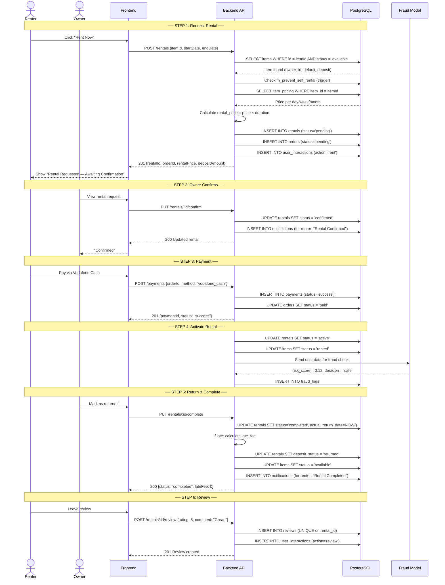
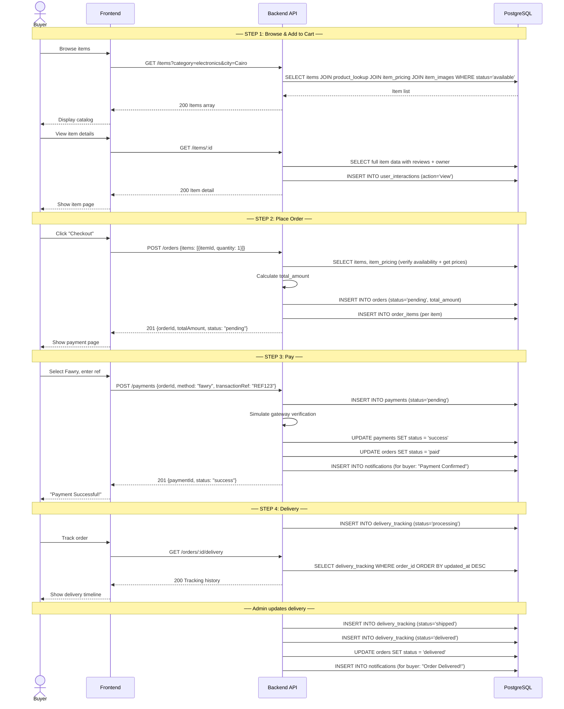
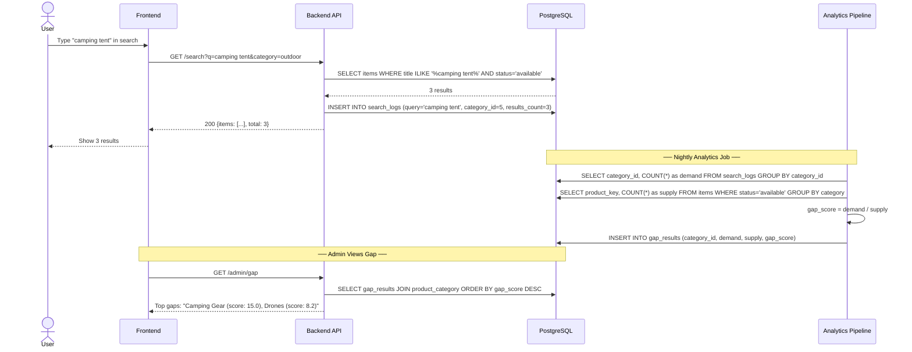
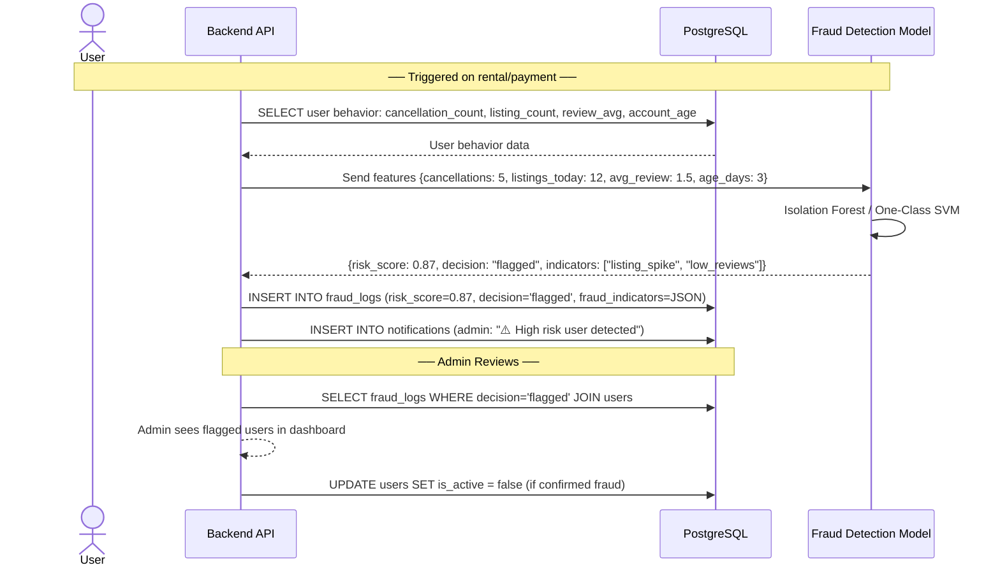

# RENTY — API ↔ DATABASE CONTRACT DOCUMENT

> Architecture Specification for Backend + Frontend Teams
> Based on the Renty PostgreSQL Schema (MVP)

---

# TABLE OF CONTENTS

1. [Full API Swagger Specification](#1-full-api-swagger-specification)
2. [Page -> API Matrix](#2-page--api-matrix)
3. [Role -> API Permission Mapping](#3-role--api-permission-mapping)
4. [Sequence Diagrams](#4-sequence-diagrams)
5. [Appendix -- API Engineering Standards](#5-appendix----api-engineering-standards)

---

# 1. FULL API SWAGGER SPECIFICATION

## Base URL: `/api/v1`

### Common Headers
```
Authorization: Bearer <JWT>
Content-Type: application/json
```

### Common Error Response
```json
{
  "error": "string",
  "message": "string",
  "statusCode": 400
}
```

---

## 1.1 AUTH MODULE

### POST `/auth/register`

| Field | Details |
|---|---|
| **Auth** | None (public) |
| **Request Body** | `{ firstName*, lastName*, email*, password*, phone }` |
| **Writes** | `users` → insert new row, `email_verifications` → insert token row, `notifications` → welcome email (optional) |
| **Business Rules** | Email must be unique. Password hashed (bcrypt). `is_verified = false`. `role_id = 1` (user). Generate UUID v4 token. Token expires in 24h. |
| **Response 201** | `{ message: "Verification email sent", userId: "uuid" }` |
| **Response 409** | `{ error: "Email already registered" }` |

---

### POST `/auth/verify-email`

| Field | Details |
|---|---|
| **Auth** | None (public) |
| **Request Body** | `{ token* }` |
| **Reads** | `email_verifications` → find by token |
| **Writes** | `email_verifications` → `is_used = true`, `users` → `is_verified = true` |
| **Business Rules** | Token must not be expired. Token must not be used. |
| **Response 200** | `{ message: "Email verified" }` |

---

### POST `/auth/login`

| Field | Details |
|---|---|
| **Auth** | None (public) |
| **Reads** | `users` → by email, `roles` → role name |
| **Writes** | `users` → `last_login_at = NOW()` |
| **Business Rules** | Must be verified. Must be active. Bcrypt compare. Return JWT (access + refresh). |
| **Response 200** | `{ accessToken, refreshToken, user: { id, firstName, lastName, email, role, profileImageUrl } }` |
| **Response 401** | `{ error: "Invalid credentials" }` |

---

### POST `/auth/refresh`

| Field | Details |
|---|---|
| **Auth** | Refresh Token |
| **Response 200** | `{ accessToken, refreshToken }` |

---

### GET `/auth/me`

| Field | Details |
|---|---|
| **Auth** | Bearer JWT |
| **Reads** | `users`, `roles` |
| **Response 200** | `{ id, firstName, lastName, email, phone, city, role, profileImageUrl, isVerified, createdAt }` |

---

### PUT `/auth/me`

| Field | Details |
|---|---|
| **Auth** | Bearer JWT |
| **Request Body** | `{ firstName, lastName, phone, address, city, profileImageUrl }` |
| **Writes** | `users` → update row (trigger auto-sets `updated_at`) |
| **Response 200** | Updated user object |

---

## 1.2 ITEMS MODULE

### GET `/items`

| Field | Details |
|---|---|
| **Auth** | Optional (public browsing allowed) |
| **Query Params** | `category`, `subcategory`, `city`, `minPrice`, `maxPrice`, `type`, `condition`, `sort` (price_asc, price_desc, newest, rating), `page`, `limit` |
| **Reads** | `items` (status='available') → JOIN `product_lookup` → JOIN `product_subcategory` → JOIN `product_category`, JOIN `item_pricing`, JOIN `item_images` (is_primary=true), LEFT JOIN `reviews` (AVG rating) |
| **Response 200** | `{ items: [{ id, title, price, city, image, rating, reviewCount, type, condition }], total, page, pages }` |

---

### GET `/items/:id`

| Field | Details |
|---|---|
| **Auth** | Optional |
| **Reads** | `items` → JOIN `product_lookup` → JOIN `product_subcategory` → JOIN `product_category`, `item_pricing` (all types), `item_images` (all), `reviews` (all + AVG), `users` (owner info: firstName, city, profileImageUrl) |
| **Writes** | `user_interactions` → action='view' (if user authenticated) |
| **Response 200** | Full item detail object with owner, prices, images, reviews |

---

### POST `/items`

| Field | Details |
|---|---|
| **Auth** | Bearer JWT (user, admin) |
| **Request Body** | `{ productKey*, title*, description, type, condition, defaultDeposit*, location, city, lat, lng, pricing*: [{ price, pricingType }], images*: [{ imageUrl, isPrimary }] }` |
| **Writes** | `items` → insert, `item_pricing` → insert per pricing type, `item_images` → insert per image |
| **Business Rules** | At least one pricing entry. At least one image. One image must be primary. Status defaults to 'available'. |
| **Response 201** | Created item object with id |

---

### PUT `/items/:id`

| Field | Details |
|---|---|
| **Auth** | Bearer JWT (owner or admin) |
| **Reads** | `items` → verify owner_id = current user |
| **Writes** | `items`, `item_pricing`, `item_images` |
| **Business Rules** | Cannot edit while status = 'rented'. Owner check unless admin. |
| **Response 200** | Updated item object |

---

### DELETE `/items/:id`

| Field | Details |
|---|---|
| **Auth** | Bearer JWT (owner or admin) |
| **Writes** | `items` → status = 'removed' (soft delete) |
| **Business Rules** | Cannot delete while status = 'rented'. |
| **Response 200** | `{ message: "Item removed" }` |

---

## 1.3 SEARCH MODULE

### GET `/search`

| Field | Details |
|---|---|
| **Auth** | Optional |
| **Query Params** | `q*` (search term), `category`, `city`, `page`, `limit` |
| **Reads** | `items` (ILIKE on title + product_name), JOIN `product_lookup`, `item_pricing`, `item_images` |
| **Writes** | `search_logs` → insert (`user_id` nullable, `query`, `category_id`, `results_count`) |
| **Business Rules** | Log every search for gap analysis. Only return status='available'. |
| **Response 200** | Same format as GET `/items` |

---

## 1.4 FAVORITES MODULE

### POST `/items/:id/favorite`

| Field | Details |
|---|---|
| **Auth** | Bearer JWT |
| **Writes** | `favorites` → insert (UNIQUE constraint prevents duplicates), `user_interactions` → action='favorite' |
| **Response 201** | `{ message: "Added to favorites" }` |
| **Response 409** | `{ error: "Already in favorites" }` |

---

### DELETE `/items/:id/favorite`

| Field | Details |
|---|---|
| **Auth** | Bearer JWT |
| **Writes** | `favorites` → delete by user_id + item_id |
| **Response 200** | `{ message: "Removed from favorites" }` |

---

### GET `/users/me/favorites`

| Field | Details |
|---|---|
| **Auth** | Bearer JWT |
| **Reads** | `favorites` → JOIN `items` → JOIN `item_images` (is_primary), JOIN `item_pricing` |
| **Response 200** | `{ items: [{ id, title, price, image, city }] }` |

---

## 1.5 RENTALS MODULE

### POST `/rentals`

| Field | Details |
|---|---|
| **Auth** | Bearer JWT |
| **Request Body** | `{ itemId*, startDate*, endDate*, pricingType }` |
| **Reads** | `items` (check status='available', get owner_id, default_deposit), `item_pricing` (get price by type) |
| **Writes** | `rentals` → insert (status='pending'), `orders` → insert (status='pending'), `user_interactions` → action='rent' |
| **Business Rules** | Trigger `fn_prevent_self_rental` blocks self-rent. Item must be status='available'. Calculate `rental_price` = price × duration. Set `deposit_amount` from item. `end_date > start_date`. |
| **Response 201** | `{ rentalId, orderId, rentalPrice, depositAmount, status: "pending" }` |

---

### GET `/rentals`

| Field | Details |
|---|---|
| **Auth** | Bearer JWT |
| **Query Params** | `status`, `page`, `limit` |
| **Reads** | `rentals` (user_id = current user) → JOIN `items` → JOIN `item_images` |
| **Response 200** | `{ rentals: [{ id, item: { title, image }, startDate, endDate, rentalPrice, status, depositStatus }] }` |

---

### GET `/rentals/:id`

| Field | Details |
|---|---|
| **Auth** | Bearer JWT (renter or item owner) |
| **Reads** | `rentals` → JOIN `items` → JOIN `item_images`, JOIN `users` (owner), `reviews` (if exists), `item_verifications` |
| **Response 200** | Full rental detail |

---

### PUT `/rentals/:id/confirm`

| Field | Details |
|---|---|
| **Auth** | Bearer JWT (item owner) |
| **Writes** | `rentals` → status = 'confirmed' |
| **Business Rules** | Only owner can confirm. Current status must be 'pending'. |
| **Response 200** | Updated rental |

---

### PUT `/rentals/:id/activate`

| Field | Details |
|---|---|
| **Auth** | Bearer JWT (admin or system) |
| **Writes** | `rentals` → status = 'active', `items` → status = 'rented' |
| **Business Rules** | Requires payment success. Current status must be 'confirmed'. |
| **Response 200** | Updated rental |

---

### PUT `/rentals/:id/complete`

| Field | Details |
|---|---|
| **Auth** | Bearer JWT (item owner or admin) |
| **Writes** | `rentals` → status = 'completed', `actual_return_date = NOW()`, compute `late_fee` if overdue. `items` → status = 'available'. `rentals` → deposit_status = 'returned' (or 'forfeited' if damaged). |
| **Business Rules** | If `actual_return_date > end_date`, calculate late_fee. Trigger verification if needed. |
| **Response 200** | `{ rentalId, status: "completed", lateFee, depositStatus }` |

---

### PUT `/rentals/:id/cancel`

| Field | Details |
|---|---|
| **Auth** | Bearer JWT (renter, before confirmed) |
| **Writes** | `rentals` → status = 'cancelled', `items` → status = 'available' (if was rented) |
| **Business Rules** | Can only cancel if status is 'pending' or 'confirmed'. |
| **Response 200** | `{ message: "Rental cancelled" }` |

---

## 1.6 ORDERS MODULE

### POST `/orders`

| Field | Details |
|---|---|
| **Auth** | Bearer JWT |
| **Request Body** | `{ items*: [{ itemId, quantity }] }` |
| **Reads** | `items`, `item_pricing` |
| **Writes** | `orders` → insert (status='pending', total_amount calculated), `order_items` → insert per item |
| **Business Rules** | All items must be status='available'. Calculate total. |
| **Response 201** | `{ orderId, totalAmount, status: "pending" }` |

---

### GET `/orders`

| Field | Details |
|---|---|
| **Auth** | Bearer JWT |
| **Reads** | `orders` (user_id = current user) → JOIN `order_items` → JOIN `items` |
| **Response 200** | `{ orders: [{ id, totalAmount, status, createdAt, itemCount }] }` |

---

### GET `/orders/:id`

| Field | Details |
|---|---|
| **Auth** | Bearer JWT (order owner or admin) |
| **Reads** | `orders` → JOIN `order_items` → JOIN `items` → JOIN `item_images`, `payments`, `delivery_tracking` |
| **Response 200** | Full order detail with items, payment status, delivery status |

---

## 1.7 PAYMENTS MODULE

### POST `/payments`

| Field | Details |
|---|---|
| **Auth** | Bearer JWT |
| **Request Body** | `{ orderId*, method*, transactionRef }` |
| **Reads** | `orders` → verify owner + status='pending' |
| **Writes** | `payments` → insert (status='pending' → 'success'/'failed'), `orders` → status = 'paid' (on success) |
| **Business Rules** | Method must be valid ENUM. Simulate payment gateway. On success: update order status. |
| **Response 201** | `{ paymentId, status, transactionRef }` |

---

### GET `/payments/:orderId`

| Field | Details |
|---|---|
| **Auth** | Bearer JWT (order owner or admin) |
| **Reads** | `payments` → by order_id |
| **Response 200** | `{ id, amount, method, status, createdAt }` |

---

## 1.8 DELIVERY MODULE

### GET `/orders/:id/delivery`

| Field | Details |
|---|---|
| **Auth** | Bearer JWT (order owner or admin) |
| **Reads** | `delivery_tracking` → by order_id, ordered by updated_at DESC |
| **Response 200** | `{ tracking: [{ status, location, updatedAt }] }` |

---

### PUT `/orders/:id/delivery`

| Field | Details |
|---|---|
| **Auth** | Bearer JWT (admin only) |
| **Writes** | `delivery_tracking` → insert new status row |
| **Response 200** | `{ message: "Delivery status updated" }` |

---

## 1.9 REVIEWS MODULE

### POST `/rentals/:id/review`

| Field | Details |
|---|---|
| **Auth** | Bearer JWT (renter only) |
| **Request Body** | `{ rating*, comment }` |
| **Reads** | `rentals` → verify user_id = current user, status = 'completed' |
| **Writes** | `reviews` → insert (UNIQUE on rental_id, CHECK rating 1-5), `user_interactions` → action='review' |
| **Business Rules** | Only completed rentals can be reviewed. One review per rental (UNIQUE index). |
| **Response 201** | `{ reviewId, rating, comment }` |

---

### GET `/items/:id/reviews`

| Field | Details |
|---|---|
| **Auth** | None (public) |
| **Reads** | `reviews` → JOIN `rentals` (item_id match) → JOIN `users` (reviewer info) |
| **Response 200** | `{ reviews: [{ id, rating, comment, reviewer: { firstName, profileImageUrl }, createdAt }], avgRating, totalReviews }` |

---

## 1.10 ITEM VERIFICATIONS MODULE

### POST `/items/:id/verify`

| Field | Details |
|---|---|
| **Auth** | Bearer JWT (expert or admin) |
| **Request Body** | `{ rentalId, checkType*, status*, notes }` |
| **Reads** | `items` → get owner_id (for self-verification check) |
| **Writes** | `item_verifications` → insert |
| **Business Rules** | Trigger `fn_prevent_self_verification` blocks expert from verifying their own item. `checkType` must be valid ENUM (before_rent / after_return). Expert is assigned by Admin. |
| **Response 201** | `{ verificationId, status }` |

---

### GET `/items/:id/verifications`

| Field | Details |
|---|---|
| **Auth** | Bearer JWT (expert, admin, item owner) |
| **Reads** | `item_verifications` → by item_id, JOIN `users` (expert info) |
| **Response 200** | `{ verifications: [{ id, checkType, status, notes, expert: { firstName }, createdAt }] }` |

---

### GET `/expert/assigned`

| Field | Details |
|---|---|
| **Auth** | Bearer JWT (expert) |
| **Reads** | `item_verifications` (expert_id = current user, status='pending') → JOIN `items` → JOIN `rentals` |
| **Response 200** | `{ assignments: [{ verificationId, item: { title, image }, rental: { startDate, endDate }, checkType, createdAt }] }` |

---

## 1.11 SUPPORT MODULE

### POST `/support/tickets`

| Field | Details |
|---|---|
| **Auth** | Bearer JWT |
| **Request Body** | `{ type*, message* }` |
| **Writes** | `support_tickets` → insert (status='open'), `support_messages` → insert first message |
| **Response 201** | `{ ticketId, status: "open" }` |

---

### GET `/support/tickets`

| Field | Details |
|---|---|
| **Auth** | Bearer JWT |
| **Reads** | `support_tickets` (user_id = current user, or ALL if admin/support role) |
| **Response 200** | `{ tickets: [{ id, type, status, createdAt, lastMessage }] }` |

---

### POST `/support/tickets/:id/messages`

| Field | Details |
|---|---|
| **Auth** | Bearer JWT (ticket owner or support/admin) |
| **Request Body** | `{ message* }` |
| **Writes** | `support_messages` → insert, `support_tickets` → updated_at (trigger) |
| **Response 201** | `{ messageId, message, createdAt }` |

---

### PUT `/support/tickets/:id/status`

| Field | Details |
|---|---|
| **Auth** | Bearer JWT (support or admin) |
| **Request Body** | `{ status* }` |
| **Writes** | `support_tickets` → status update |
| **Response 200** | Updated ticket |

---

## 1.12 CHAT MODULE

### POST `/chats`

| Field | Details |
|---|---|
| **Auth** | Bearer JWT |
| **Request Body** | `{ userId* }` (other user) |
| **Writes** | `chats` → insert (UNIQUE on user1_id, user2_id) |
| **Response 201** | `{ chatId }` |

---

### GET `/chats`

| Field | Details |
|---|---|
| **Auth** | Bearer JWT |
| **Reads** | `chats` (where user1_id or user2_id = current user) → JOIN `users` (other party), latest `chat_messages` |
| **Response 200** | `{ chats: [{ id, otherUser: { firstName, profileImageUrl }, lastMessage, unreadCount }] }` |

---

### POST `/chats/:id/messages`

| Field | Details |
|---|---|
| **Auth** | Bearer JWT (chat participant) |
| **Request Body** | `{ message* }` |
| **Writes** | `chat_messages` → insert (is_read=false) |
| **Response 201** | `{ messageId, message, createdAt }` |

---

### GET `/chats/:id/messages`

| Field | Details |
|---|---|
| **Auth** | Bearer JWT (chat participant) |
| **Reads** | `chat_messages` → by chat_id, ordered by created_at |
| **Writes** | `chat_messages` → set is_read=true for other user's messages |
| **Response 200** | `{ messages: [{ id, senderId, message, isRead, createdAt }] }` |

---

## 1.13 NOTIFICATIONS MODULE

### GET `/notifications`

| Field | Details |
|---|---|
| **Auth** | Bearer JWT |
| **Reads** | `notifications` (user_id = current user, ordered by created_at DESC) |
| **Response 200** | `{ notifications: [{ id, title, message, isRead, createdAt }], unreadCount }` |

---

### PUT `/notifications/:id/read`

| Field | Details |
|---|---|
| **Auth** | Bearer JWT |
| **Writes** | `notifications` → is_read = true |
| **Response 200** | `{ message: "Marked as read" }` |

---

### PUT `/notifications/read-all`

| Field | Details |
|---|---|
| **Auth** | Bearer JWT |
| **Writes** | `notifications` → is_read = true WHERE user_id = current user |
| **Response 200** | `{ message: "All marked as read" }` |

---

## 1.14 RECOMMENDATIONS MODULE (AI)

### GET `/recommendations`

| Field | Details |
|---|---|
| **Auth** | Bearer JWT |
| **Reads** | `recommendations` (user_id = current user, ordered by score DESC) → JOIN `items` → JOIN `item_images` → JOIN `item_pricing` |
| **Response 200** | `{ recommendations: [{ id, item: { id, title, price, image, city }, score, reason, algorithm }] }` |

---

### PUT `/recommendations/:id/click`

| Field | Details |
|---|---|
| **Auth** | Bearer JWT |
| **Writes** | `recommendations` → is_clicked = true, `user_interactions` → action='click' |
| **Response 200** | `{ message: "Click recorded" }` |

---

## 1.15 ADMIN — KPI MODULE

### GET `/admin/kpis`

| Field | Details |
|---|---|
| **Auth** | Bearer JWT (admin, super_admin) |
| **Query Params** | `period` (daily/weekly/monthly), `from`, `to` |
| **Reads** | `kpis_snapshots_derived` |
| **Response 200** | `{ snapshots: [{ date, activeUsers, newUsers, rentals, revenue, fraudRate, recommendationCtr, ... }] }` |

---

### GET `/admin/kpis/latest`

| Field | Details |
|---|---|
| **Auth** | Bearer JWT (admin, super_admin) |
| **Reads** | `kpis_snapshots_derived` → latest row |
| **Response 200** | Single KPI snapshot object |

---

## 1.16 ADMIN — GAP ANALYSIS MODULE

### GET `/admin/gap`

| Field | Details |
|---|---|
| **Auth** | Bearer JWT (admin, super_admin) |
| **Query Params** | `period`, `limit` |
| **Reads** | `gap_results` → JOIN `product_category`, ordered by gap_score DESC |
| **Response 200** | `{ gaps: [{ categoryName, demand, supply, gapScore, recommendations, createdAt }] }` |

---

## 1.17 ADMIN — FRAUD MODULE

### GET `/admin/fraud`

| Field | Details |
|---|---|
| **Auth** | Bearer JWT (admin, super_admin) |
| **Query Params** | `decision` (safe/flagged/blocked), `minRisk`, `page`, `limit` |
| **Reads** | `fraud_logs` → JOIN `users` |
| **Response 200** | `{ logs: [{ id, user: { id, firstName, email }, riskScore, decision, reason, fraudIndicators, createdAt }] }` |

---

## 1.18 ADMIN — USERS MANAGEMENT

### GET `/admin/users`

| Field | Details |
|---|---|
| **Auth** | Bearer JWT (admin, super_admin) |
| **Reads** | `users` → JOIN `roles` |
| **Response 200** | Paginated user list with role, isVerified, isActive, createdAt |

---

### PUT `/admin/users/:id/status`

| Field | Details |
|---|---|
| **Auth** | Bearer JWT (super_admin) |
| **Writes** | `users` → is_active = true/false |
| **Response 200** | Updated user |

---

---

# 2. PAGE → API MATRIX

| Frontend Page | APIs Consumed | Auth Required |
|---|---|---|
| **Register** | `POST /auth/register` | ❌ |
| **Verify Email** | `POST /auth/verify-email` | ❌ |
| **Login** | `POST /auth/login` | ❌ |
| **Home** | `GET /items` (featured), `GET /recommendations` | Optional / ✅ |
| **Browse / Catalog** | `GET /items`, `GET /search` | ❌ |
| **Search Results** | `GET /search` | ❌ |
| **Item Details** | `GET /items/:id`, `GET /items/:id/reviews`, `POST /items/:id/favorite`, `DELETE /items/:id/favorite` | Optional / ✅ |
| **Add Item** | `POST /items` | ✅ |
| **Edit Item** | `PUT /items/:id` | ✅ (owner) |
| **My Items** | `GET /items?owner=me` | ✅ |
| **Favorites** | `GET /users/me/favorites` | ✅ |
| **Rent Modal** | `POST /rentals` | ✅ |
| **My Rentals** | `GET /rentals` | ✅ |
| **Rental Details** | `GET /rentals/:id`, `PUT /rentals/:id/confirm`, `PUT /rentals/:id/complete`, `PUT /rentals/:id/cancel` | ✅ |
| **Leave Review** | `POST /rentals/:id/review` | ✅ |
| **Checkout** | `POST /orders` | ✅ |
| **Payment** | `POST /payments` | ✅ |
| **My Orders** | `GET /orders` | ✅ |
| **Order Details** | `GET /orders/:id`, `GET /orders/:id/delivery`, `GET /payments/:orderId` | ✅ |
| **Chat List** | `GET /chats` | ✅ |
| **Chat Room** | `GET /chats/:id/messages`, `POST /chats/:id/messages` | ✅ |
| **Profile** | `GET /auth/me`, `PUT /auth/me` | ✅ |
| **Notifications** | `GET /notifications`, `PUT /notifications/:id/read`, `PUT /notifications/read-all` | ✅ |
| **Support** | `POST /support/tickets`, `GET /support/tickets`, `POST /support/tickets/:id/messages` | ✅ |
| **Admin Dashboard** | `GET /admin/kpis/latest`, `GET /admin/kpis` | ✅ (admin) |
| **Admin Gap Analysis** | `GET /admin/gap` | ✅ (admin) |
| **Admin Fraud Panel** | `GET /admin/fraud` | ✅ (admin) |
| **Admin Users** | `GET /admin/users`, `PUT /admin/users/:id/status` | ✅ (admin) |
| **Admin Support** | `GET /support/tickets` (all), `PUT /support/tickets/:id/status` | ✅ (support/admin) |
| **Expert Panel** | `GET /expert/assigned`, `POST /items/:id/verify`, `GET /items/:id/verifications` | ✅ (expert) |

---

# 3. ROLE → API PERMISSION MAPPING

## Roles

| Role ID | Name | Description |
|---|---|---|
| 1 | `user` | Regular renter/lender |
| 2 | `admin` | Platform administrator |
| 3 | `support` | Support team member |
| 4 | `super_admin` | Full system access |
| 5 | `expert` | Verified technical inspector (assigned by Admin) |

### Expert Role — Detailed Responsibilities

- Perform item verification: **before_rent** and **after_return**
- Update `item_verifications` with status (approved/rejected) + notes
- Confirm item condition
- Flag damaged items
- Recommend deposit forfeiture (all or partial) if necessary

**Expert restrictions:**
- Cannot rent items
- Cannot verify their own items (enforced by `fn_prevent_self_verification` trigger)
- Cannot modify financial data or fraud decisions
- Assigned to items by Admin

## Permission Matrix

| API Endpoint | user | expert | admin | support | super_admin |
|---|---|---|---|---|---|
| **AUTH** | | | | | |
| `POST /auth/register` | ✅ public | ✅ public | ✅ public | ✅ public | ✅ public |
| `POST /auth/login` | ✅ public | ✅ public | ✅ public | ✅ public | ✅ public |
| `GET /auth/me` | ✅ | ✅ | ✅ | ✅ | ✅ |
| `PUT /auth/me` | ✅ | ✅ | ✅ | ✅ | ✅ |
| **ITEMS** | | | | | |
| `GET /items` | ✅ public | ✅ | ✅ | ✅ | ✅ |
| `GET /items/:id` | ✅ public | ✅ | ✅ | ✅ | ✅ |
| `POST /items` | ✅ | ❌ | ✅ | ❌ | ✅ |
| `PUT /items/:id` | ✅ (own) | ❌ | ✅ (any) | ❌ | ✅ |
| `DELETE /items/:id` | ✅ (own) | ❌ | ✅ (any) | ❌ | ✅ |
| **SEARCH** | | | | | |
| `GET /search` | ✅ public | ✅ | ✅ | ✅ | ✅ |
| **FAVORITES** | | | | | |
| `POST /items/:id/favorite` | ✅ | ❌ | ✅ | ❌ | ✅ |
| `DELETE /items/:id/favorite` | ✅ | ❌ | ✅ | ❌ | ✅ |
| `GET /users/me/favorites` | ✅ | ❌ | ✅ | ❌ | ✅ |
| **RENTALS** | | | | | |
| `POST /rentals` | ✅ | ❌ | ❌ | ❌ | ✅ |
| `GET /rentals` | ✅ (own) | ❌ | ✅ (all) | ❌ | ✅ |
| `PUT /rentals/:id/confirm` | ✅ (owner) | ❌ | ✅ | ❌ | ✅ |
| `PUT /rentals/:id/activate` | ❌ | ❌ | ✅ | ❌ | ✅ |
| `PUT /rentals/:id/complete` | ✅ (owner) | ❌ | ✅ | ❌ | ✅ |
| `PUT /rentals/:id/cancel` | ✅ (renter) | ❌ | ✅ | ❌ | ✅ |
| **ORDERS** | | | | | |
| `POST /orders` | ✅ | ❌ | ❌ | ❌ | ✅ |
| `GET /orders` | ✅ (own) | ❌ | ✅ (all) | ❌ | ✅ |
| **PAYMENTS** | | | | | |
| `POST /payments` | ✅ | ❌ | ❌ | ❌ | ✅ |
| **DELIVERY** | | | | | |
| `GET /orders/:id/delivery` | ✅ (own) | ❌ | ✅ | ✅ | ✅ |
| `PUT /orders/:id/delivery` | ❌ | ❌ | ✅ | ❌ | ✅ |
| **REVIEWS** | | | | | |
| `POST /rentals/:id/review` | ✅ (renter) | ❌ | ❌ | ❌ | ✅ |
| `GET /items/:id/reviews` | ✅ public | ✅ | ✅ | ✅ | ✅ |
| **VERIFICATIONS** | | | | | |
| `POST /items/:id/verify` | ❌ | ✅ (assigned) | ✅ | ❌ | ✅ |
| `GET /items/:id/verifications` | ✅ (owner) | ✅ (assigned) | ✅ | ❌ | ✅ |
| `GET /expert/assigned` | ❌ | ✅ | ❌ | ❌ | ✅ |
| **SUPPORT** | | | | | |
| `POST /support/tickets` | ✅ | ✅ | ✅ | ✅ | ✅ |
| `GET /support/tickets` | ✅ (own) | ✅ (own) | ✅ (all) | ✅ (all) | ✅ |
| `POST /support/tickets/:id/messages` | ✅ (own) | ✅ (own) | ✅ | ✅ | ✅ |
| `PUT /support/tickets/:id/status` | ❌ | ❌ | ✅ | ✅ | ✅ |
| **CHAT** | | | | | |
| `POST /chats` | ✅ | ❌ | ✅ | ❌ | ✅ |
| `GET /chats` | ✅ (own) | ❌ | ✅ (own) | ❌ | ✅ |
| `POST /chats/:id/messages` | ✅ (participant) | ❌ | ✅ | ❌ | ✅ |
| **NOTIFICATIONS** | | | | | |
| `GET /notifications` | ✅ | ✅ | ✅ | ✅ | ✅ |
| `PUT /notifications/:id/read` | ✅ | ✅ | ✅ | ✅ | ✅ |
| **RECOMMENDATIONS** | | | | | |
| `GET /recommendations` | ✅ | ❌ | ❌ | ❌ | ✅ |
| **ADMIN** | | | | | |
| `GET /admin/kpis` | ❌ | ❌ | ✅ | ❌ | ✅ |
| `GET /admin/gap` | ❌ | ❌ | ✅ | ❌ | ✅ |
| `GET /admin/fraud` | ❌ | ❌ | ✅ | ❌ | ✅ |
| `GET /admin/users` | ❌ | ❌ | ✅ | ❌ | ✅ |
| `PUT /admin/users/:id/status` | ❌ | ❌ | ❌ | ❌ | ✅ |

---

# 4. SEQUENCE DIAGRAMS

## 4.1 Rental Flow (Complete Lifecycle)



---

## 4.2 Buy / Order Flow



---

## 4.3 Search → Gap Analysis Data Flow



---

## 4.4 Fraud Detection Flow



---

# 5. APPENDIX -- API Engineering Standards

## 5.1 Standard HTTP Status Codes

Every endpoint MUST return appropriate status codes. Backend developers should map responses using this table:

| Code | Name | When to Use |
|------|------|-------------|
| 200 | OK | Successful GET, PUT, DELETE |
| 201 | Created | Successful POST that creates a resource |
| 204 | No Content | Successful DELETE with no response body |
| 400 | Bad Request | Missing required fields, malformed JSON |
| 401 | Unauthorized | Missing or expired JWT token |
| 403 | Forbidden | Valid token but insufficient role/permission |
| 404 | Not Found | Resource ID does not exist |
| 409 | Conflict | Duplicate resource (e.g., favorite already exists, email taken) |
| 422 | Unprocessable Entity | Business rule violation (e.g., renting own item, reviewing before completion) |
| 429 | Too Many Requests | Rate limit exceeded |
| 500 | Internal Server Error | Unhandled server exception |

### Error Response Format (Standard)

```json
{
  "error": "VALIDATION_ERROR",
  "message": "startDate must be greater than or equal to today",
  "statusCode": 400,
  "details": [
    { "field": "startDate", "rule": "gte", "value": "2024-01-01" }
  ]
}
```

### Per-Endpoint Status Code Reference

| Endpoint | 200 | 201 | 400 | 401 | 403 | 404 | 409 | 422 |
|----------|-----|-----|-----|-----|-----|-----|-----|-----|
| `POST /auth/register` | | Y | Y | | | | Y (email) | |
| `POST /auth/login` | Y | | Y | Y | | | | |
| `POST /items` | | Y | Y | Y | Y | | | |
| `GET /items/:id` | Y | | | | | Y | | |
| `POST /rentals` | | Y | Y | Y | Y | Y | | Y (self-rent, unavailable) |
| `POST /items/:id/favorite` | | Y | | Y | | Y | Y | |
| `POST /payments` | | Y | Y | Y | | Y (order) | | Y (already paid) |
| `POST /rentals/:id/review` | | Y | Y | Y | | Y | Y (already reviewed) | Y (not completed) |
| `POST /items/:id/verify` | | Y | Y | Y | Y | Y | | Y (self-verify) |
| `PUT /admin/users/:id/status` | Y | | Y | Y | Y (not super_admin) | Y | | |

---

## 5.2 Request/Response Examples (Complex Endpoints)

### POST `/items` -- Full Example

**Request:**
```json
{
  "productKey": 12,
  "title": "Mountain Bike - Trek Marlin 7",
  "description": "Like new mountain bike, used 3 times. Comes with helmet.",
  "type": "rental",
  "condition": "like_new",
  "defaultDeposit": 500.00,
  "location": "Maadi, Cairo",
  "city": "Cairo",
  "lat": 29.9602,
  "lng": 31.2569,
  "pricing": [
    { "price": 150.00, "pricingType": "daily" },
    { "price": 800.00, "pricingType": "weekly" },
    { "price": 2500.00, "pricingType": "monthly" }
  ],
  "images": [
    { "imageUrl": "https://res.cloudinary.com/renty/bike_front.jpg", "isPrimary": true },
    { "imageUrl": "https://res.cloudinary.com/renty/bike_side.jpg", "isPrimary": false }
  ]
}
```

**Response 201:**
```json
{
  "id": "f47ac10b-58cc-4372-a567-0e02b2c3d479",
  "title": "Mountain Bike - Trek Marlin 7",
  "status": "available",
  "createdAt": "2026-03-03T10:30:00Z"
}
```

---

### POST `/rentals` -- Full Example

**Request:**
```json
{
  "itemId": "f47ac10b-58cc-4372-a567-0e02b2c3d479",
  "startDate": "2026-03-10",
  "endDate": "2026-03-15",
  "pricingType": "daily"
}
```

**Response 201:**
```json
{
  "rentalId": "a1b2c3d4-e5f6-7890-abcd-ef1234567890",
  "orderId": "b2c3d4e5-f6a7-8901-bcde-f12345678901",
  "rentalPrice": 750.00,
  "depositAmount": 500.00,
  "status": "pending"
}
```

**Response 422 (self-rental):**
```json
{
  "error": "BUSINESS_RULE_VIOLATION",
  "message": "You cannot rent your own item",
  "statusCode": 422
}
```

---

### POST `/payments` -- Full Example

**Request:**
```json
{
  "orderId": "b2c3d4e5-f6a7-8901-bcde-f12345678901",
  "method": "vodafone_cash",
  "transactionRef": "VOD-2026-03-03-1234"
}
```

**Response 201:**
```json
{
  "paymentId": "c3d4e5f6-a7b8-9012-cdef-123456789012",
  "amount": 1250.00,
  "method": "vodafone_cash",
  "status": "success",
  "transactionRef": "VOD-2026-03-03-1234"
}
```

---

## 5.3 Validation Rules

Backend MUST enforce these rules. Frontend SHOULD validate client-side for UX.

### Auth
| Field | Rule |
|-------|------|
| `email` | Valid email format, max 255 chars |
| `password` | Min 8 chars, at least 1 uppercase, 1 number |
| `firstName`, `lastName` | Required, 1-100 chars, no special characters |
| `phone` | Egyptian format: `01[0-2,5][0-9]{8}` |
| `nationalId` | Exactly 14 digits |

### Items
| Field | Rule |
|-------|------|
| `title` | Required, 3-200 chars |
| `description` | Max 2000 chars |
| `type` | Must be ENUM: `rental`, `sale`, `both` |
| `condition` | Must be: `new`, `like_new`, `good`, `fair` |
| `defaultDeposit` | Decimal >= 0 |
| `pricing[].price` | Decimal > 0 |
| `pricing[].pricingType` | Must be: `daily`, `weekly`, `monthly` |
| `images` | Min 1 image, max 10. Exactly one `isPrimary: true` |
| `lat` | -90 to 90 |
| `lng` | -180 to 180 |

### Rentals
| Field | Rule |
|-------|------|
| `startDate` | ISO 8601, must be >= today |
| `endDate` | ISO 8601, must be > startDate |
| `pricingType` | Must match an existing pricing entry for the item |

### Orders
| Field | Rule |
|-------|------|
| `items[].quantity` | Integer > 0 |
| `items[].itemId` | Must exist and be status='available' |

### Reviews
| Field | Rule |
|-------|------|
| `rating` | Integer 1-5 (CHECK constraint in DB) |
| `comment` | Max 1000 chars, optional |

### Payments
| Field | Rule |
|-------|------|
| `method` | Must be ENUM: `vodafone_cash`, `fawry`, `paymob`, `credit_card`, `bank_transfer` |
| `transactionRef` | Optional, max 100 chars |

---

## 5.4 Idempotency Keys

For endpoints that create resources or trigger side effects, the client SHOULD send an idempotency key header to prevent duplicates on retry.

```
X-Idempotency-Key: <UUID v4>
```

| Endpoint | Idempotency Required | Reason |
|----------|---------------------|--------|
| `POST /payments` | Required | Prevents double charging |
| `POST /rentals` | Recommended | Prevents duplicate rental on double-click |
| `POST /orders` | Recommended | Prevents duplicate orders |
| `POST /items` | Optional | Less critical but good practice |

### Backend Implementation

1. Store idempotency key in Redis/cache with TTL = 24h.
2. On duplicate key: return cached response, do NOT re-execute.
3. On new key: execute, cache response, return.

---

## 5.5 Rate Limiting

| Endpoint Category | Limit (MVP) | Limit (Production) |
|---|---|---|
| `POST /auth/login` | 10 req/min per IP | 5 req/min per IP |
| `POST /auth/register` | 5 req/min per IP | 3 req/min per IP |
| `GET /search` | 30 req/min per user | 20 req/min per user |
| `POST /payments` | 5 req/min per user | 3 req/min per user |
| All other authenticated | 60 req/min per user | 30 req/min per user |
| All public GET | 120 req/min per IP | 60 req/min per IP |

Response on rate limit exceeded:
```json
{
  "error": "RATE_LIMIT_EXCEEDED",
  "message": "Too many requests. Try again in 45 seconds.",
  "statusCode": 429,
  "retryAfter": 45
}
```

Header: `Retry-After: 45`

---

## 5.6 Webhooks and Async Events (Production Roadmap)

For MVP, payments and delivery are simulated synchronously. In production:

| Event | Trigger | Webhook/Async Action |
|-------|---------|---------------------|
| Payment completed | Gateway callback | `POST /webhooks/payment` updates payment + order status |
| Payment failed | Gateway callback | `POST /webhooks/payment` marks payment failed, sends notification |
| Delivery status update | Logistics API | `POST /webhooks/delivery` inserts delivery_tracking row |
| Fraud alert | AI model async | Background job writes to fraud_logs, sends admin notification |
| KPI snapshot | n8n scheduled job | Nightly pipeline computes and inserts into kpis_snapshots_derived |
| Gap analysis | n8n scheduled job | Nightly pipeline computes and inserts into gap_results |

MVP note: All above are handled synchronously in API handlers or via n8n cron jobs. No real webhook endpoints needed for MVP.

---

## 5.7 Soft Delete Semantics

`DELETE /items/:id` does NOT physically delete the row.

| Action | What Happens | Visible In |
|--------|-------------|-----------|
| User "deletes" item | `items.status = 'removed'` | Not visible in browse/search |
| Admin suspends item | `items.status = 'suspended'` | Not visible in browse/search |
| Historical rentals | Rental records remain with FK to item | My Rentals, Admin views |
| Reviews | Reviews remain linked to completed rentals | Not shown (item hidden) |

Rules:
- Items with status `removed` or `suspended` are excluded from all public queries (`WHERE status = 'available'`).
- The item data is preserved for: rental history, dispute resolution, analytics, and audit.
- Physical deletion is only done by super_admin via direct DB access (not via API).

---

## 5.8 Environment Configuration

| Variable | Default (Dev) | Production | Used By |
|----------|--------------|------------|---------|
| `JWT_ACCESS_TOKEN_EXPIRY` | 60m | 15m | Auth middleware |
| `JWT_REFRESH_TOKEN_EXPIRY` | 30d | 7d | Auth refresh endpoint |
| `EMAIL_VERIFICATION_TOKEN_EXPIRY` | 48h | 24h | Register flow |
| `PASSWORD_RESET_TOKEN_EXPIRY` | 2h | 1h | Password reset |
| `BCRYPT_SALT_ROUNDS` | 10 | 12 | Password hashing |
| `MAX_FILE_UPLOAD_SIZE` | 10MB | 5MB | Cloudinary upload |
| `MAX_IMAGES_PER_ITEM` | 10 | 10 | Item creation |
| `PAGINATION_DEFAULT_LIMIT` | 20 | 20 | All paginated endpoints |
| `PAGINATION_MAX_LIMIT` | 100 | 50 | All paginated endpoints |
| `CLOUDINARY_CLOUD_NAME` | - | - | Image uploads |
| `CLOUDINARY_API_KEY` | - | - | Image uploads |
| `CLOUDINARY_API_SECRET` | - | - | Image uploads |
| `DATABASE_URL` | localhost:5432 | Azure/Supabase | DB connection |
| `CORS_ALLOWED_ORIGINS` | `http://localhost:4200` | `https://renty.app` | CORS middleware |
| `FRAUD_MODEL_URL` | localhost:8000 | Azure ML endpoint | Fraud detection |
| `RECOMMENDATION_MODEL_URL` | localhost:8001 | Azure ML endpoint | Recommendations |

---

## 5.9 CORS Policy

Since frontend (Angular/Flutter web) and backend (ASP.NET Core) are deployed on different domains:

```csharp
// ASP.NET Core Program.cs
builder.Services.AddCors(options =>
{
    options.AddPolicy("RentyPolicy", policy =>
    {
        policy.WithOrigins(
            "https://renty.app",
            "https://admin.renty.app",
            "http://localhost:4200"  // dev only
        )
        .AllowAnyHeader()
        .AllowAnyMethod()
        .AllowCredentials();
    });
});
```

Required headers on every response:
```
Access-Control-Allow-Origin: <origin>
Access-Control-Allow-Methods: GET, POST, PUT, DELETE, OPTIONS
Access-Control-Allow-Headers: Content-Type, Authorization, X-Idempotency-Key
Access-Control-Allow-Credentials: true
```

---

## 5.10 File Upload Workflow

The API does NOT accept binary file uploads. Images are uploaded to Cloudinary by the frontend, and the resulting URL is passed to the API.

### Upload Flow

```
1. Frontend: User selects image file
2. Frontend: Upload to Cloudinary (direct client upload)
   POST https://api.cloudinary.com/v1_1/{cloud_name}/image/upload
   → Returns: { secure_url: "https://res.cloudinary.com/renty/..." }
3. Frontend: Send image URL to API
   POST /items  { images: [{ imageUrl: "https://res.cloudinary.com/...", isPrimary: true }] }
4. Backend: Validates URL format, stores in item_images table
```

### Cloudinary Upload Preset (unsigned, for frontend)

```json
{
  "upload_preset": "renty_items",
  "folder": "renty/items",
  "allowed_formats": ["jpg", "jpeg", "png", "webp"],
  "max_file_size": 5242880,
  "transformation": [
    { "width": 1200, "height": 900, "crop": "limit", "quality": "auto" }
  ]
}
```

### Profile Image Upload

Same flow but with preset `renty_profiles` and folder `renty/profiles`.

### Backend Validation

The API MUST validate:
- URL starts with `https://res.cloudinary.com/`
- URL ends with valid image extension
- No more than 10 images per item
- Exactly one `isPrimary: true` image per item
